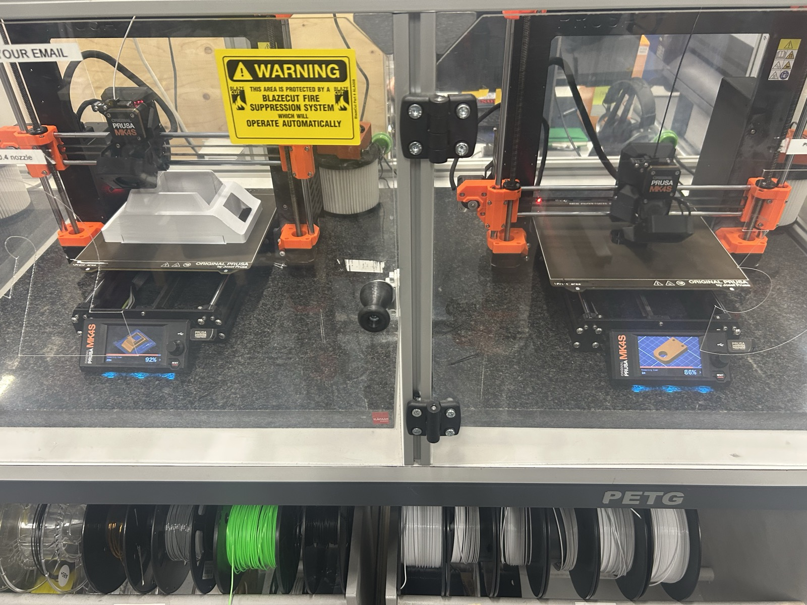
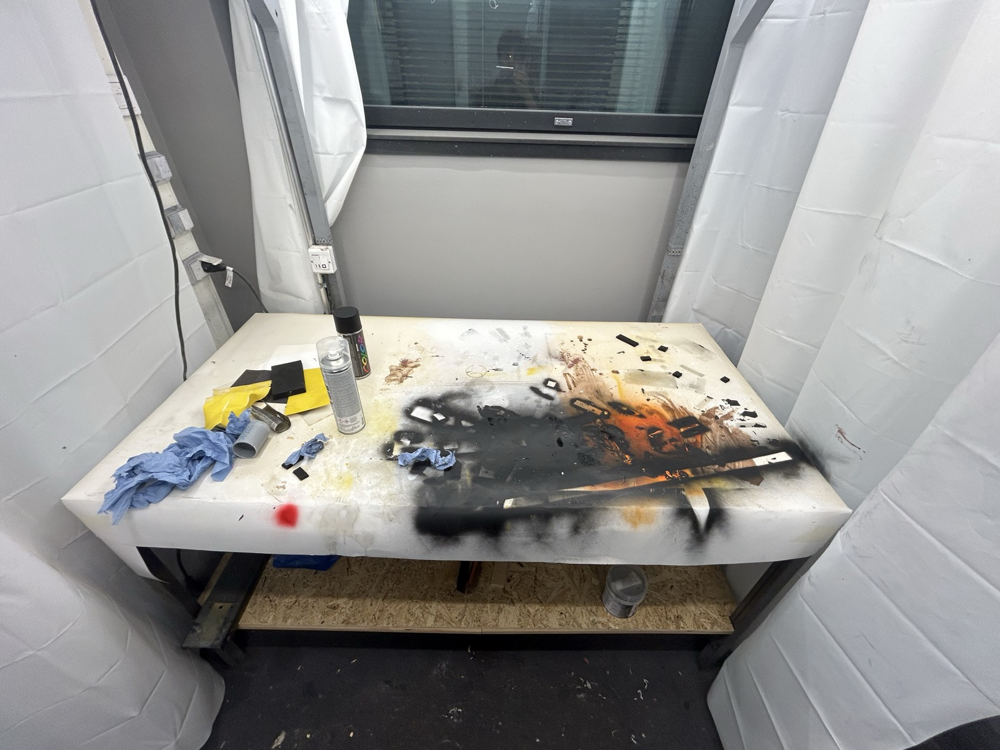
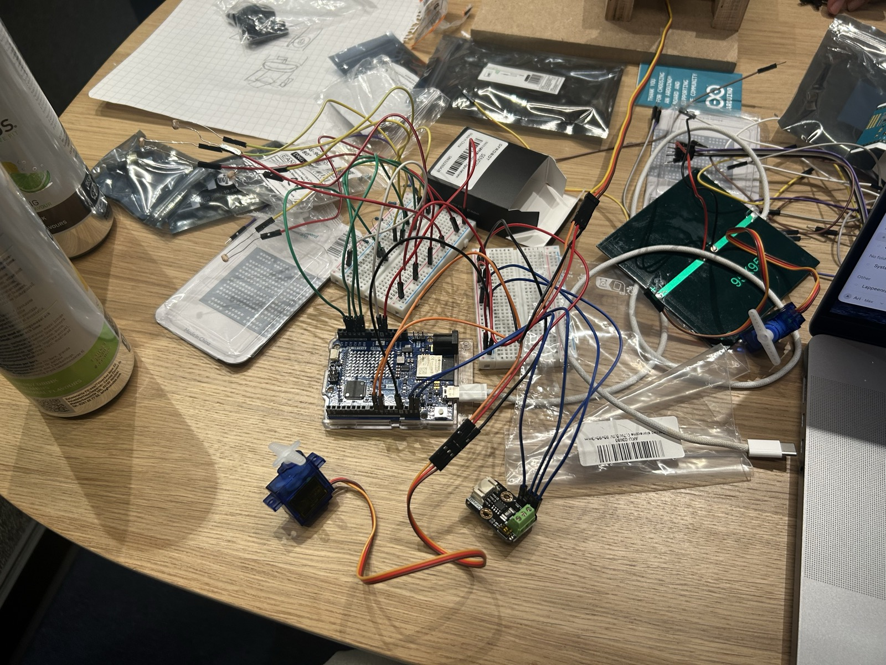
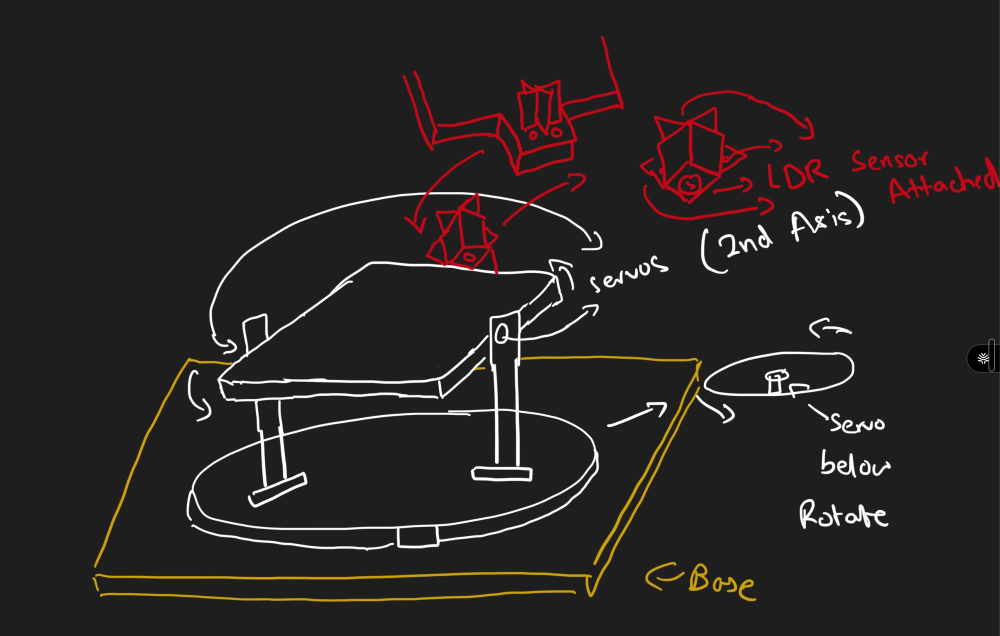
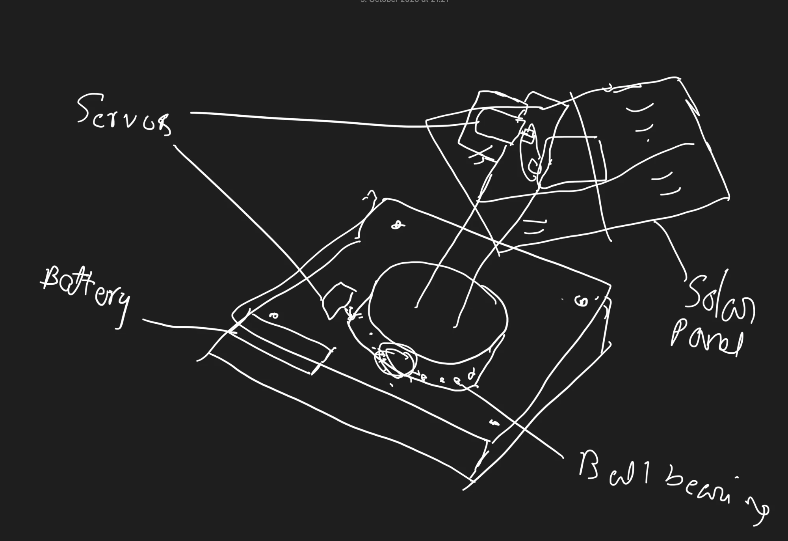
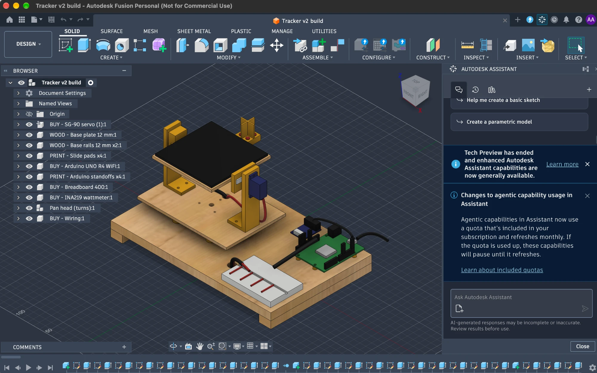

# Low-cost dual-axis solar tracker

Our project for the LUTES Deep Tech Hackathon 2026 (demo day: 11 October 2026).

- **Team name:** Wise Guys
- **Track:** Challenge 02, dual-axis solar tracker
- **Demo videos:** [submission/tracker_demo.mp4](submission/tracker_demo.mp4) (25 s: the real tracker following a torch) and [submission/tracker_demo_2.mp4](submission/tracker_demo_2.mp4) (29 s: a second run on the real tracker)
- **Pitch deck:** shown live at the pitch

## What it is

1. A small solar panel that turns to face the brightest light on two axes.
2. Four light sensors sit at the corners of the panel. The board compares them and moves the motors until all four see about the same light.
3. A browser dashboard shows the tracker in 3D, tells its story, simulates real weather, and controls the real board over USB.
4. On the real board, the tracker can detect dust and rock the panel back and forth to clean it.

## How it works

1. **Read the light.** Four GL5528 light sensors (LDRs) with 10k resistors feed pins A0 to A3.
2. **Compare sides.** Top against bottom sets the tilt. Left against right sets the turn.
3. **Move.** The big motor (MG996R, continuous 360 degree servo, pin D9) turns the panel. The small motor (SG-90, pin D10) tilts it.
4. **Measure.** The small 0.7 W solar cell is measured on pin A4, so we can see if the move helped.
5. **Clean.** If dust blocks the lights, the panel tilts to one side, measures, tilts to the other side, measures, and goes toward the side that helps.

The full steering rules are written at the top of [`firmware/tracker/tracker.ino`](firmware/tracker/tracker.ino).

## Hardware

| Part | Job | Pin |
| --- | --- | --- |
| Arduino UNO R4 WiFi | The brain | USB to the laptop |
| MG996R 360 degree servo ("big motor") | Turns the panel (pan) | D9 |
| SG-90 servo ("small motor") | Tilts the panel | D10 |
| 4 x GL5528 light sensors + 4 x 10k resistors | See where the light is | A0 to A3 |
| 0.7 W solar cell | Measures the energy we get | A4 |

How it is built, bottom to top: a wooden base, the big motor between two wood blocks, a slippery plastic (UHMW) plate as the bearing, a pipe up to a spinning block, a metal rod turned by the small motor, and a wooden plate with the solar cell in the middle and the four light sensors at the corners.

- Part list and specs: [`cad/parts_specs.md`](cad/parts_specs.md)
- Wiring, step by step: [`wiring/breadboard_guide.html`](wiring/breadboard_guide.html) (open it in a browser)
- 3D printed parts (STL) and the CAD script: [`cad/`](cad/)

## How to run

### Upload the firmware

1. Open `firmware/tracker/tracker.ino` in the Arduino IDE.
2. Pick the board "Arduino UNO R4 WiFi" and its port.
3. Click Upload.

Small test sketches (servo test, wiring check, power probe) are in [`firmware/`](firmware/). A simulated copy for Wokwi is in [`wokwi/`](wokwi/).

### Start the dashboard

1. Run `python3 dashboard/serve.py`.
2. Open http://127.0.0.1:8765 in Chrome or Edge (they support Web Serial).
3. Pick a mode:
   - **Story:** a short narrated story of the project.
   - **Simulation:** the tracker in real hourly weather from 2023 to 2025 at three places.
   - **Live:** plug in the board and connect. Use **Sync up** for the guided calibration. Each run is saved as a session log in `dashboard/logs/` (kept out of git).

The design notes for the dashboard are in [`dashboard/REVAMP.md`](dashboard/REVAMP.md). Tests are in `dashboard/tests/`.

## Research

1. [Solar problems in Mongolia, India and Pakistan](reports/Solar%20problems%20Mongolia%20India%20Pakistan.md)
2. [Solar tracker innovation opportunities](reports/Solar%20tracker%20innovation%20opportunities.md)
3. [Solar tracker net energy research](reports/Solar%20tracker%20net%20energy%20research.md)

The source notes for each report are in [`research_notes/`](research_notes/).

## Photos and sketches

| | | |
| --- | --- | --- |
|  |  |  |
| 3D printing | Painting the parts | Wiring everything |
|  |  |  |
| First sketch | The base and the bearing | Fusion 360 model |

## Team

We are a team of three:

1. Aayan
2. Gauravan
3. Togo

One of us works on business, one on software and one on electronics.

During the hackathon we learned 3D printing, spray painting, wood cutting and screwing. The JHC lab mentors helped us.

## Repo map

| Folder | What is inside |
| --- | --- |
| `firmware/` | Arduino code for the tracker and bench tests |
| `dashboard/` | The browser dashboard |
| `wiring/` | The breadboard wiring guide |
| `cad/` | Printed parts, renders and the CAD script |
| `wokwi/` | The Wokwi simulation copy |
| `reports/`, `research_notes/` | Research and sources |
| `submission/` | Hackathon submission files (issue text, video, pitch deck) |
